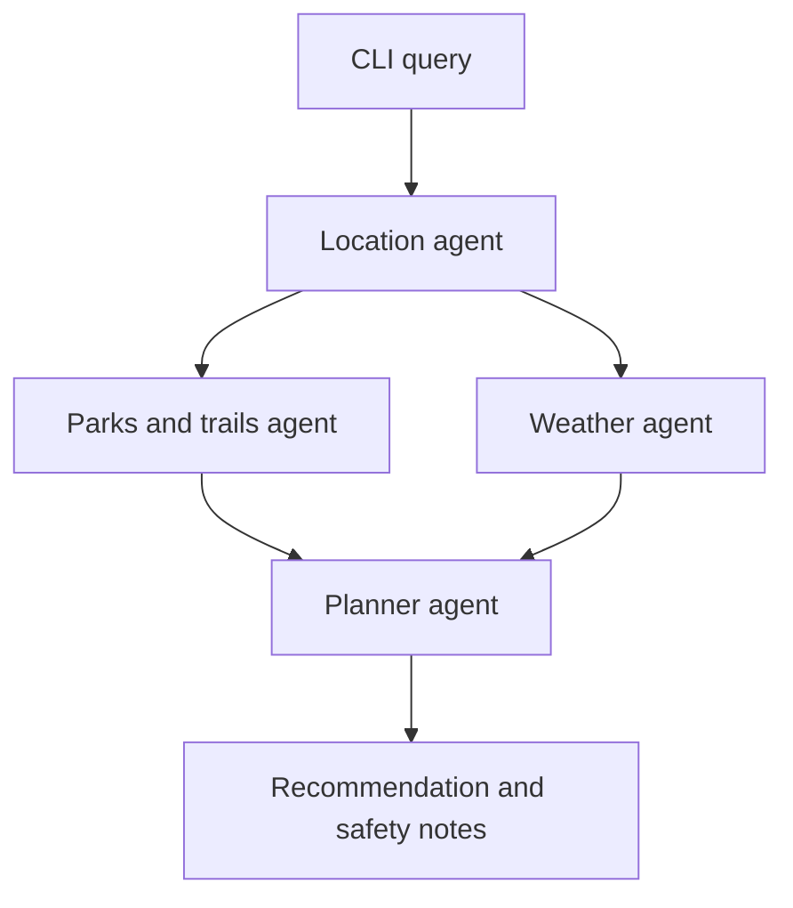

# Hike agent

Multi-agent hike planner. You give it a place. A LangGraph runs a location agent, then a parks agent and a weather agent together, then a planner that writes a short recommendation and keeps the safety notes.

The default model is still local Ollama `gpt-oss:20b`. Set `MODEL_PROVIDER=openai` to use the OpenAI API, or set `OPENAI_BASE_URL` for another OpenAI-compatible server.

## Why a graph, not a routing model

The hike workflow does not need a model to decide what to do next. Coordinates have to exist before parks or weather can be looked up. Parks and weather do not depend on each other. The recommendation has to see both, including alerts.

A supervisor model that picks the next agent can skip the weather call or name a park that was never returned. This graph is the supervisor, and that choice is settled: location, then parks and weather together, then the planner. A language model does not choose which agent runs. The planner is the only model call, and it is told to use the reports it was given. If that model is down, the factual brief is printed anyway, so the safety notes are not lost.



Each specialist tries an MCP server first and falls back to a direct API if that server is missing, slow, or returns an error.

## Data sources

Parks, in order:

1. **Local National Park Service MCP**, when `NPS_API_KEY` is set. The same [cyanheads/national-parks-mcp-server](https://github.com/cyanheads/national-parks-mcp-server) package, started with `npx` on this machine so the request uses our network and our key. Tools: `nps_find_parks`, `nps_get_activities`, `nps_get_alerts`.
2. **Hosted NPS MCP** at `https://national-parks.caseyjhand.com/mcp`. No client key. Used when the local server is unavailable, and also when no key is set.
3. **NPS REST API**, the same `/parks` and `/thingstodo` calls the original script made, plus `/alerts`. Requires `NPS_API_KEY` (free from the [NPS developer portal](https://www.nps.gov/subjects/developer/get-started.htm)).
4. **OpenStreetMap** (Nominatim, then Overpass) when every NPS path fails. Each of those places has `source: openstreetmap` and `nps_verified: false`. The plan prints `not verified by NPS` on the option and again in the notes.

Weather, in order:

1. **[@dangahagan/weather-mcp](https://github.com/weather-mcp/weather-mcp)** via `npx`. Keyless. NOAA for US points, Open-Meteo elsewhere, plus alerts (`get_forecast`, `get_alerts`).
2. **Open-Meteo hourly forecast** and **api.weather.gov alerts**. The daylight summary (08:00–17:00, average temperature, common conditions, highest precipitation chance) matches the original script. NWS alerts can mark the day unsafe even when the sky looks clear.

Location uses the Open-Meteo geocoding API. It is keyless and does not start a subprocess. `me` still uses this machine's public IP, as the original script did.

Other MCP servers that were considered, and why they are not the default:

| Source | Decision |
| --- | --- |
| Pipeworx NPS gateway (`gateway.pipeworx.io/nps/mcp`) | Same NPS data, a small free tier, and a large unrelated tool list on the same connection. |
| StackOne NPS connector | Needs an account token. |
| `AniruddhaShukla/nps-mcp` | Local server that still needs an NPS key, with less trip-planning structure. |
| Unscoped npm package `weather-mcp` | A different project from the maintained weather server. |
| NWS-only MCP servers | Covered by `@dangahagan/weather-mcp`, which also works outside the US. |

`langchain-mcp-adapters` is not installed. From LangChain 1.4, that package is unmaintained and its client moved to `langchain.mcp.MCPAdapter`. This app uses that adapter (`langchain[mcp]`).

## Setup

```bash
python -m venv .venv
source .venv/bin/activate
pip install -r requirements.txt
cp .env.example .env
```

For the original model:

```bash
ollama pull gpt-oss:20b
```

Weather MCP needs Node.js on `PATH` when `WEATHER_MCP_ENABLED` is true. The parks MCP URL is hosted HTTP and does not need Node. The first `npx` launch downloads the weather server; if that exceeds `WEATHER_MCP_TIMEOUT_SECONDS`, the Open-Meteo fallback runs.

```bash
python -m hike_agent "Boulder, Colorado"
python main.py "Yosemite Valley"
python -m hike_agent me --chat
```

`--chat` asks follow-up questions after the recommendation. That loop needs a reachable model. `--json` prints the graph state.

## Tests

```bash
pip install -r requirements-dev.txt
pytest
```

Each agent's tools are tested with fake HTTP and MCP responses. One test compiles the LangGraph and checks that a place flows through parks and weather into the planner.

## Environment

Copy `.env.example`. Do not commit a filled-in `.env`.

| Variable | Purpose |
| --- | --- |
| `MODEL_PROVIDER` | `ollama` (default) or `openai` |
| `MODEL_NAME` | Default `gpt-oss:20b` |
| `OLLAMA_BASE_URL` | Default `http://127.0.0.1:11434` |
| `OPENAI_API_KEY` | Required when `MODEL_PROVIDER=openai` |
| `OPENAI_BASE_URL` | Optional base URL for an OpenAI-compatible server |
| `NPS_API_KEY` | Starts the local NPS MCP server and, if that fails, calls the NPS REST API |
| `NPS_MCP_COMMAND`, `NPS_MCP_ARGS` | How the local NPS MCP process is started. Ignored when `NPS_API_KEY` is empty |
| `NPS_MCP_URL` | Hosted parks MCP server, used after the local server |
| `NPS_MCP_ENABLED` | `false` skips both NPS MCP servers |
| `NPS_MCP_TIMEOUT_SECONDS` | How long to wait on each NPS MCP server before the next source |
| `WEATHER_MCP_ENABLED` | `false` uses Open-Meteo and NWS only |
| `WEATHER_MCP_COMMAND`, `WEATHER_MCP_ARGS` | How the weather MCP process is started |
| `WEATHER_MCP_TIMEOUT_SECONDS` | How long to wait before the weather fallback |
| `HTTP_TIMEOUT_SECONDS` | Timeout for direct API calls |
| `HIKE_USER_AGENT` | Sent to NWS, Nominatim, and Overpass |

## Layout

```
hike_agent/
  cli.py            command line
  graph.py          LangGraph supervisor
  model.py          Ollama or OpenAI chat model
  mcp_bridge.py     MCPAdapter tool calls
  agents/           location, parks, weather, planner
  services/         direct HTTP clients
tests/              tool tests and one graph test
main.py             same entrypoint as python -m hike_agent
```

## Safety

The recommendation is not a permit and not a forecast office. An empty alert list is not an all-clear. Thunderstorms, heavy precipitation, extreme or severe NWS alerts, and dangerous temperatures are marked unsafe, and the planner is told not to send you out that day. Check the park's own alerts before you leave the trailhead.
